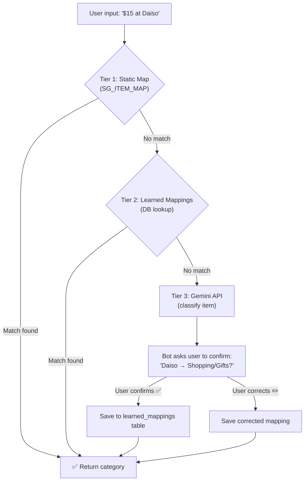

# Spend Again? — Final Implementation Plan (v3)

> Updated from v2 with: Groceries as standalone category, dynamic item learning system.

---

## Decisions Summary

| Decision | Choice |
|---|---|
| Database | **PostgreSQL + Drizzle ORM** (Supabase free tier) |
| API Framework | **Hono** |
| LLM Provider | **Google Gemini** (free tier) |
| Bot Framework | **grammY** |
| Receipt OCR | **Gemini Vision** (Approach B) |
| NLP Parsing | **Hybrid** (regex + learned mappings + Gemini) |
| Frontend | **React + Vite** |
| Deployment | **Vercel** (dashboard) + **Railway** (bot + API) |
| Auth | **Telegram Login Widget** → JWT |
| "Merchant" field | **Renamed to "Item"** |
| Categories | **Hierarchical** (Category → Sub-Category), **Groceries is top-level** |
| Item Mapping | **3-tier lookup** (static → learned DB → Gemini), NOT a full ML model |
| Notification Scraping | **Forwarded SMS parsing** (simplified alternative) |
| Budget | **Free tier everything** |

---

## 1. Updated Category System

```typescript
type Category =
  | "Food"
  | "Transport"
  | "Groceries"      // ← Promoted to top-level
  | "Shopping"
  | "Housing"
  | "Utilities"
  | "School"
  | "Investments"
  | "Holiday"
  | "Entertainment"
  | "Healthcare"
  | "Other";

const CATEGORY_MAP: Record<Category, string[]> = {
  Food:          ["Hawker", "Restaurant", "Drinks", "Alcohol", "Snacks", "Delivery"],
  Groceries:     ["Supermarket", "Wet Market", "Online Groceries", "Convenience Store"],
  Transport:     ["MRT", "Bus", "Grab", "Taxi", "Fuel", "Parking"],
  Shopping:      ["Clothes", "Electronics", "Gifts", "Online", "Personal Care"],
  Housing:       ["Rent", "HDB Loan", "Maintenance", "Furniture"],
  Utilities:     ["Electricity", "Water", "Internet", "Mobile", "Gas"],
  School:        ["Tuition", "Books", "Supplies", "Course Fees"],
  Investments:   ["Stocks", "Crypto", "Savings", "Insurance"],
  Holiday:       ["Flights", "Hotels", "Activities", "Souvenirs"],
  Entertainment: ["Movies", "Games", "Subscriptions", "Sports"],
  Healthcare:    ["Doctor", "Pharmacy", "Dental", "Gym"],
  Other:         ["Miscellaneous"],
};
```

Updated SG static map:
```typescript
const SG_ITEM_MAP = {
  // Groceries (now top-level)
  "ntuc":         { category: "Groceries", subCategory: "Supermarket" },
  "fairprice":    { category: "Groceries", subCategory: "Supermarket" },
  "cold storage": { category: "Groceries", subCategory: "Supermarket" },
  "sheng siong":  { category: "Groceries", subCategory: "Supermarket" },
  "giant":        { category: "Groceries", subCategory: "Supermarket" },
  "cheers":       { category: "Groceries", subCategory: "Convenience Store" },
  "7-eleven":     { category: "Groceries", subCategory: "Convenience Store" },

  // Transport
  "grab":         { category: "Transport", subCategory: "Grab" },
  "gojek":        { category: "Transport", subCategory: "Taxi" },
  "comfort":      { category: "Transport", subCategory: "Taxi" },
  "ezlink":       { category: "Transport", subCategory: "MRT" },
  "simplygo":     { category: "Transport", subCategory: "MRT" },

  // Food
  "mcdonalds":    { category: "Food", subCategory: "Restaurant" },
  "koi":          { category: "Food", subCategory: "Drinks" },
  "liho":         { category: "Food", subCategory: "Drinks" },
  "starbucks":    { category: "Food", subCategory: "Drinks" },
  "kopitiam":     { category: "Food", subCategory: "Hawker" },

  // Utilities
  "singtel":      { category: "Utilities", subCategory: "Mobile" },
  "starhub":      { category: "Utilities", subCategory: "Mobile" },
  "m1":           { category: "Utilities", subCategory: "Mobile" },
};
```

---

## 2. Dynamic Item Learning (3-Tier Lookup)

> [!IMPORTANT]
> **Not a full ML model** — that's overkill for this stage. Instead, we use a **database-backed learning system** where Gemini does the intelligence and PostgreSQL does the memory.

### How It Works



### Database Schema

```typescript
// packages/db/src/schema.ts (addition)

const learnedMappings = pgTable("learned_mappings", {
  id: uuid("id").primaryKey().defaultRandom(),
  itemName: text("item_name").notNull(),           // normalized lowercase
  category: text("category").notNull(),
  subCategory: text("sub_category").notNull(),
  confidence: real("confidence").default(1.0),      // 1.0 = user-confirmed
  source: text("source").notNull(),                 // "gemini" | "user_corrected"
  usageCount: integer("usage_count").default(1),    // popularity tracking
  createdAt: timestamp("created_at").defaultNow(),
  updatedAt: timestamp("updated_at").defaultNow(),
});
```

### Why This Beats ML

| Approach | Pros | Cons |
|---|---|---|
| **Full ML model** | Generalizes well | Needs training data, GPU, retraining pipeline, complex infra |
| **3-Tier Lookup (our approach)** | Zero training, instant learning, user-validated quality, Gemini handles edge cases | Relies on exact/fuzzy string match for Tier 2 |

The 3-tier system gives you **learning behavior** without ML complexity. Over time, the `learned_mappings` table grows into a high-quality, user-validated dictionary. If you ever want ML later, this table becomes your **training dataset**.

---

## 3. Core Transaction Schema

```typescript
interface Transaction {
  id: string;
  userId: string;
  amount: number;              // stored as cents (integer)
  currency: "SGD";
  item: string;                // what was purchased
  category: Category;
  subCategory: string;
  date: Date;                  // DD/MM/YYYY display
  source: "manual" | "sms" | "receipt" | "bot";
  rawInput?: string;
  confidence: number;          // 0–1
  createdAt: Date;
  updatedAt: Date;
}
```

---

## 4. Auth Flow

1. **Register**: User creates account on web-app → pop-up links to Telegram bot (deep link)
2. **Bot linking**: Bot `/start` with token → links Telegram ID ↔ User account
3. **Same-device login**: "Go to Dashboard" button in bot → deep link with auth token → JWT
4. **Cross-device login**: Telegram Login Widget on dashboard → validate → JWT
5. **Bot as AI chat**: User queries spending ("how much on food?") → bot queries API → responds

---

## 5. Architecture

```
spend-again/
├── apps/
│   ├── bot/              # grammY + webhook
│   ├── api/              # Hono REST API
│   └── dashboard/        # React + Vite
├── packages/
│   ├── shared/           # Types, categories, SG mappings
│   ├── parser/           # 3-tier parsing engine
│   └── db/               # Drizzle schema + queries
├── turbo.json
├── pnpm-workspace.yaml
└── package.json
```

**Deploy**: Dashboard → Vercel | Bot + API → Railway | DB → Supabase

---

## 6. Phased Roadmap

| Phase | Scope | Timeline |
|---|---|---|
| **1. Foundation** | Monorepo scaffold, DB schema, basic bot commands | Week 1–2 |
| **2. AI Parsing** | Regex parser, Gemini integration, 3-tier lookup, SMS parsing | Week 3–4 |
| **3. API + Auth** | Hono routes, Telegram Login Widget, JWT, account linking | Week 5–6 |
| **4. Dashboard** | React UI, charts, transaction history, auth flow | Week 7–8 |
| **5. Receipt OCR** | Gemini Vision, image handling, confirmation flow | Week 9–10 |
| **6. Polish** | Singlish bot personality, error handling, deploy | Week 11+ |

---

## 7. AGENTS.md & CLAUDE.md Amendments

Both files need updates for: Item (not Merchant), Groceries as top-level category, full tech stack, corrected `pnpm add` syntax, and project structure reference. Will apply as diffs upon approval.

---

## Approval

- [ ] Groceries as standalone category looks correct
- [ ] 3-tier dynamic mapping approach is acceptable (vs full ML)
- [ ] Ready to begin scaffolding
